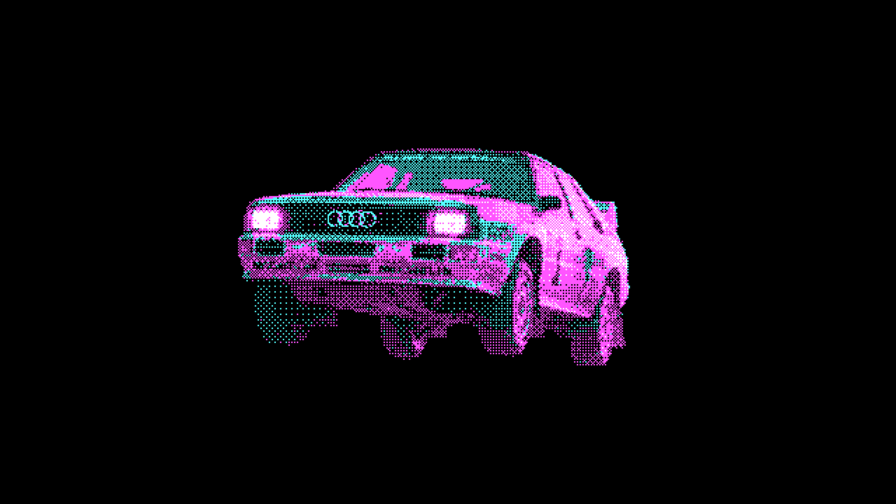
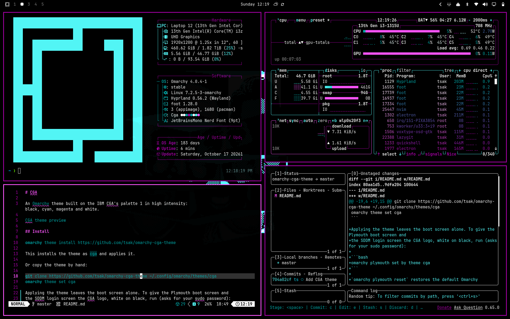
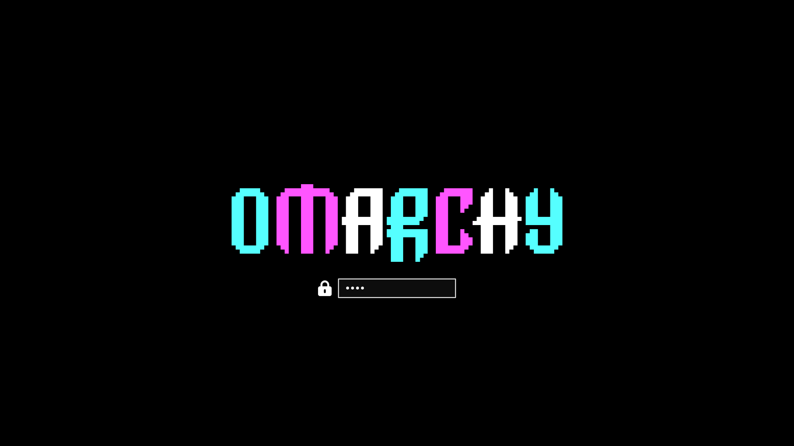
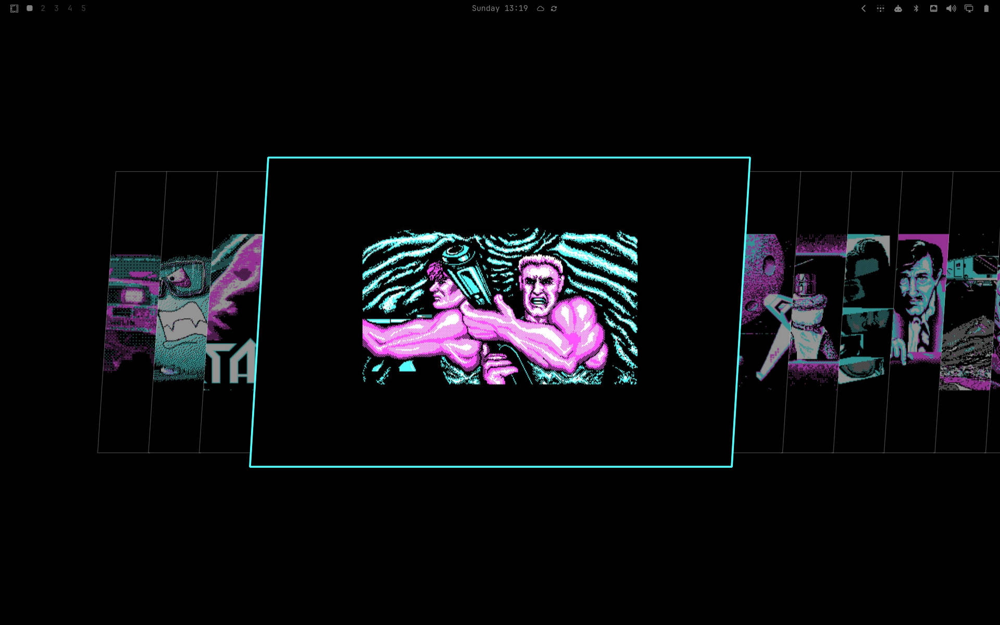

# Omarchy CGA theme

An [Omarchy](https://omarchy.org/) theme built on the IBM CGA's palette 1 in high intensity: black, cyan, magenta and white.





## Install

```bash
omarchy theme install https://github.com/tsak/omarchy-cga-theme
```

This installs the theme as `cga` and applies it.

Or copy the theme by hand:

```bash
git clone https://github.com/tsak/omarchy-cga-theme ~/.config/omarchy/themes/cga
omarchy theme set cga
```

Applying the theme leaves the boot screen alone. To give the Plymouth boot screen and
the SDDM login screen the CGA logo, white on black, run (asks for your sudo password):

```bash
omarchy plymouth set by theme cga
```



`omarchy plymouth reset` restores the default Omarchy screens.

## Palette

| Color   | Hex       | Used for                                     |
|---------|-----------|----------------------------------------------|
| Black   | `#000000` | Background                                   |
| Cyan    | `#55ffff` | Accent; green, cyan and blue terminal colors |
| Magenta | `#ff55ff` | Selection, active window border; red and magenta terminal colors |
| White   | `#ffffff` | Foreground; yellow terminal color            |

A terminal expects 16 colors, so the normal ANSI slots use CGA's low-intensity variants
(`#00aaaa`, `#aa00aa`, `#aaaaaa`) and the bright slots use the high-intensity ones.
The one color outside CGA is `#002a2a`, a near-black teal for panel backgrounds, so they
stand apart from the black desktop.

Omarchy generates the terminal, editor, btop and shell configs from `colors.toml`.

## Contents

| File                     | Purpose                                                       |
|--------------------------|---------------------------------------------------------------|
| `colors.toml`            | Palette and Hyprland window border colors                     |
| `icons.theme`            | Icon theme (`Yaru-magenta-dark`)                              |
| `unlock.png`             | Lock screen logo, letters alternating cyan, magenta and white |
| `preview.png`            | Theme picker image                                            |
| `preview-shell.png`      | Screenshot of terminal apps in the theme (README only)        |
| `preview-wallpapers.png` | Screenshot of the background switcher (README only)           |
| `preview-plymouth.png`   | Plymouth boot screen preview (README only)                    |
| `backgrounds/`           | 15 wallpapers, 3840×2160, using only the four CGA colors      |

Cycle wallpapers with `omarchy theme bg next`. `01-cga-quattro-car.png` sorts first,
so it is the one shown when the theme is applied.

## Wallpapers



Every wallpaper is drawn on the same grid: one CGA pixel is a 6×6 block, centred on a
black 3840×2160 canvas. Omarchy scales wallpapers with smoothing, and a 6-pixel block
shrinks to whole pixels at 2560×1440 (4) and 1920×1080 (3), so the dithering stays crisp
on 4K, 1440p and 1080p screens. Other resolutions get a slightly soft image.

The wallpaper images belong to their original authors.
